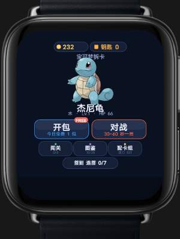
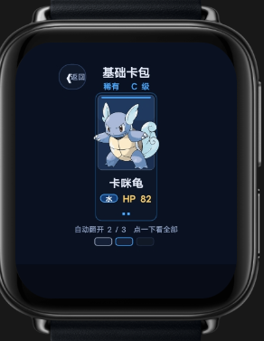
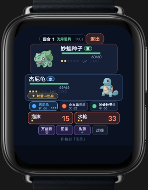
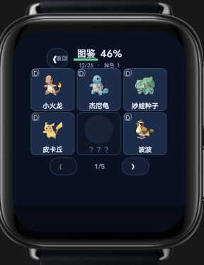

# 宝可梦拆卡版

一款面向智能手表的宝可梦卡牌收集游戏。开卡包收集卡片、查看图鉴、配置卡组，再带着喜欢的宝可梦进入对战。

## 玩法简介

- **开包收集**：从基础卡包中获取卡牌，逐步扩充收藏。
- **卡组配置**：挑选已获得的卡牌，搭配自己的队伍。
- **进入对战**：使用宝可梦与技能进行回合制对战。
- **完成图鉴**：查看收集进度，发现尚未获得的卡片。

## 游戏截图

| 首页 | 基础卡包 |
| --- | --- |
|  |  |

| 对战界面 | 图鉴 |
| --- | --- |
|  |  |

## 下载

- [下载 RPK 安装包](downloads/com.sci.spiritcard-1.0.0-debug.rpk)

## 安装包信息

- 包名：`com.sci.spiritcard`
- 版本：`1.0.0`（versionCode `1`）
- 设备类型：方形表盘、圆形表盘
- 构建类型：Debug

仓库收录的是提供的 RPK 安装包和演示截图，不包含游戏源代码。安装需要兼容 RPK 的手表运行环境。
